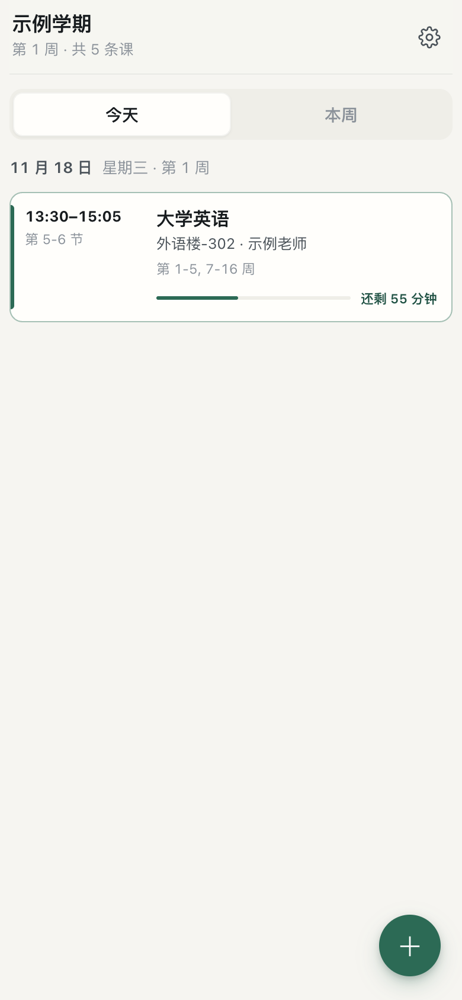
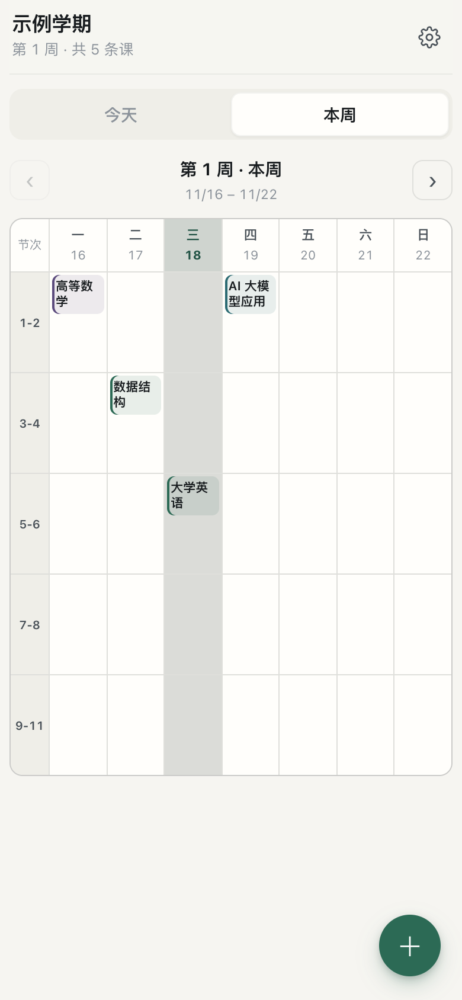
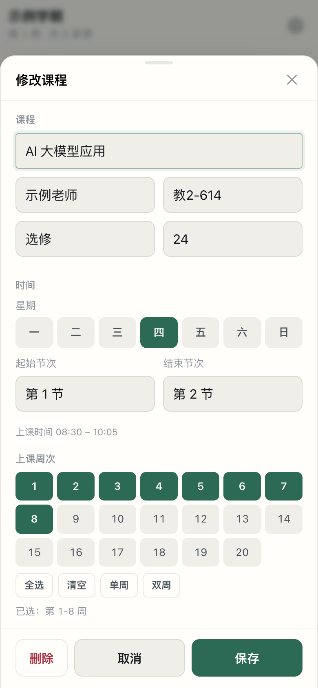

# 小雨课程表 · 网页版

一个**单页、离线可用**的课程表。打开即用，不需要装 App，也没有「7 天证书过期」这回事。

原版是 SwiftUI 写的 iOS App，日常在用。唯一的问题是：Apple 免费开发者签名只有 7 天有效期，过期后 App 直接打不开，得插线在 Xcode 里重跑一次。这个网页版就是为这件事做的——**一次打开，之后断网也能用，再也不用管证书**。

<table>
<tr>
<td align="center"> <b>今天</b> 正在上的那节带进度条</td>
<td align="center"> <b>本周</b> 5 时段 × 7 天，点空格加课</td>
<td align="center"> <b>编辑课程</b> 周次点选，支持单双周</td>
</tr>
</table>

## 怎么用

**在线**（推荐，手机加到主屏幕后可离线）：
<https://zhangganyu55-glitch.github.io/xiaoyu-timetable-web/>

**本地**：直接把 `index.html` 拖进浏览器，双击也行。`file://` 下所有功能都成立——没有服务器、没有请求、没有依赖。

**装到手机**：Safari 打开上面的网址 → 分享 → 「添加到主屏幕」。

## 功能

- **今天**：当天全部课程，显示时间、节次、教室、教师、上课周次。正在上的那一节有一条把真实时间算进去的进度条和「还剩 N 分钟」，下一节会标出开始时间。
- **本周**：5 个节次时段（1-2 / 3-4 / 5-6 / 7-8 / 9-11）× 周一至周日。点空格子就在那天那节加课，点课程块直接改，可左右翻周、一键回到本周。
- **自动算周次**：只要告诉它第 1 周的周一，之后「今天是第几周、这门课这周上不上」全部自动算。开学前会提示「还没开学」。
- **手动增删改**：课程名、教师、教室、课程性质、学时、星期、起止节次、上课周次（点选 + 全选 / 清空 / 单周 / 双周）。
- **离线**：Service Worker 缓存整个 App，断网照样打开。
- **数据本地**：浏览器 `localStorage` 存储，不上传任何服务器；支持 JSON 导出 / 导入，换设备或清缓存前导出一下即可。
- 深色模式跟随系统；桌面端自动切换成居中宽版。

## 和 iOS 版的差别

| | iOS 版 | 网页版 |
| --- | --- | --- |
| 证书 / 签名 | 免费签名 7 天过期 | 没有这个概念 |
| 安装 | Xcode 装机 | 打开网址，或存成本地文件 |
| 图片导入（Vision OCR） | 有 | **没有**（见下） |
| 其余功能 | — | 对齐，周次算法与 `WeekCalculator` 一致 |

没做图片导入的原因：浏览器端 OCR 要下载几十 MB 的模型（Tesseract.js / PaddleOCR-js），与「单文件、离线、零依赖」直接冲突。真需要的话可以单独做一个带模型的版本。

## 自己部署一份

1. 把本仓库推到自己的 GitHub
2. Settings → Pages → Source 选 `main` 分支 `/root`
3. 访问 `https://<你的用户名>.github.io/<仓库名>/`

不需要构建，这就是几个静态文件。

## 数据与隐私

**仓库里不含任何真实课表**，示例数据全是虚构的（`index.html` 里的 `DEMO`）。你自己的课表只存在浏览器的 `localStorage` 里，或者你主动导出的 JSON 文件里。

## 实现说明

没有框架、没有构建、没有依赖：一个 `index.html`（内联 CSS + 原生 JS）、一个 `manifest.webmanifest`、一个 `sw.js`、四个图标。

- 配色：课表纸的白 + 黑板墨绿；层次全靠 1px 淡边框，不用阴影堆叠（只有浮层例外）。
- 周次计算与 Swift 版一致：第 1 周 = `[第1周周一, +7天)`，用 floor 除法，开学前返回 0 或负数。
- 课程配色只做识别用：6 个低饱和色按课程名哈希，同一门课永远同一个颜色。
